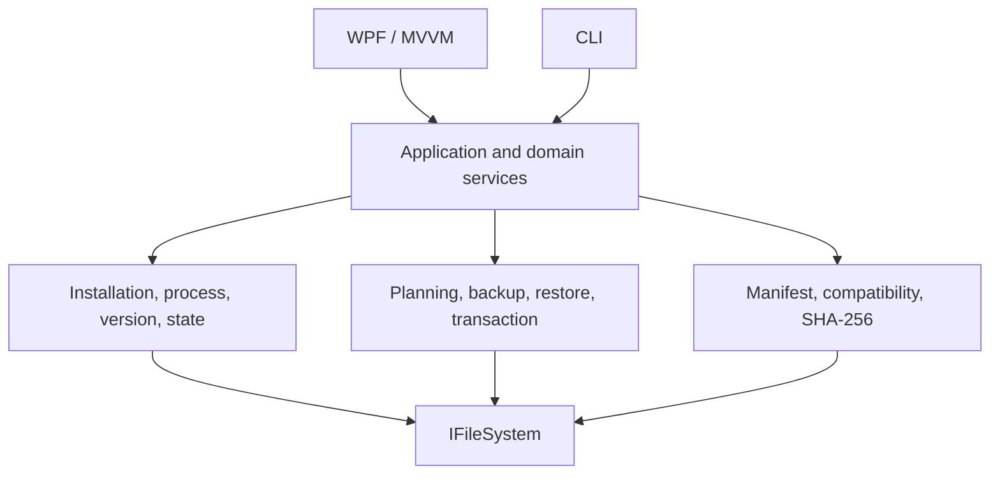

# Architecture

## Projects

- `ValorantMatureContent.Core`: models, boundaries, detection, manifests, integrity, backup/restore, plans, execution, settings, logging, diagnostics, and update contracts.
- `ValorantMatureContent.Cli`: argument/output presentation and exit-code mapping only.
- `ValorantMatureContent.Desktop`: WPF view and asynchronous MVVM presentation only.
- `ValorantMatureContent.Core.Tests`: deterministic domain and state tests.
- `ValorantMatureContent.IntegrationTests`: temporary filesystem transaction tests.

## Safety Invariants

1. Unknown game builds are incompatible.
2. Payload and backup bytes are SHA-256 verified before use.
3. No game file changes occur before a verified snapshot exists.
4. New files are staged and verified before they replace destinations.
5. A failed operation restores and verifies the safety snapshot; rollback failure is reported distinctly.
6. Plans drive dry-run and execution, avoiding separate behavior paths.
7. Enable and disable are idempotent for already-valid states.

## State Model

`Disabled` requires all four original files and no mature files. `Enabled` requires all four mature files, no originals, valid hashes, and known compatibility. Mixed sets are `Conflict`; incomplete sets are `Partial`; missing or hash-invalid state is `Corrupted`; installed content on an unsupported build is `Unsupported`.

## Data Locations

Settings, JSON Lines logs, and backup history live under `%LOCALAPPDATA%\ValorantMatureContentManager`. Game paths are stored only when a user chooses a manual installation. Diagnostic reports replace the current user-profile prefix with `%USERPROFILE%`.

## Updates

`IApplicationUpdateService` and `IPayloadUpdateService` are independent boundaries. A future GitHub Releases implementation must use HTTPS and verify payload manifests and files before presenting an explicit user-controlled install plan.